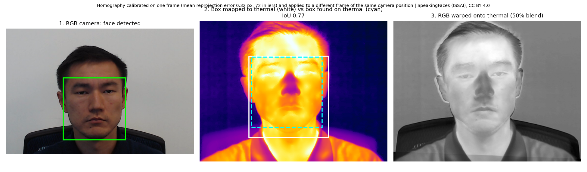
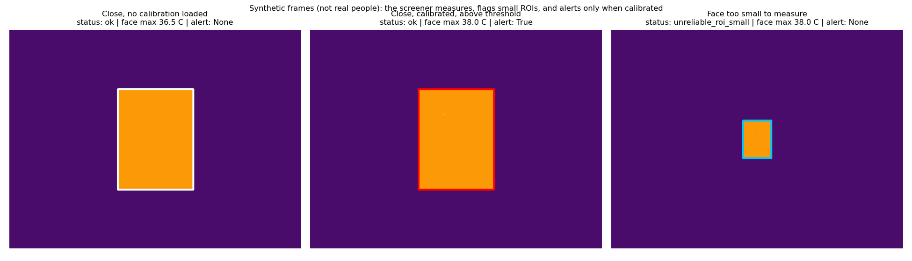
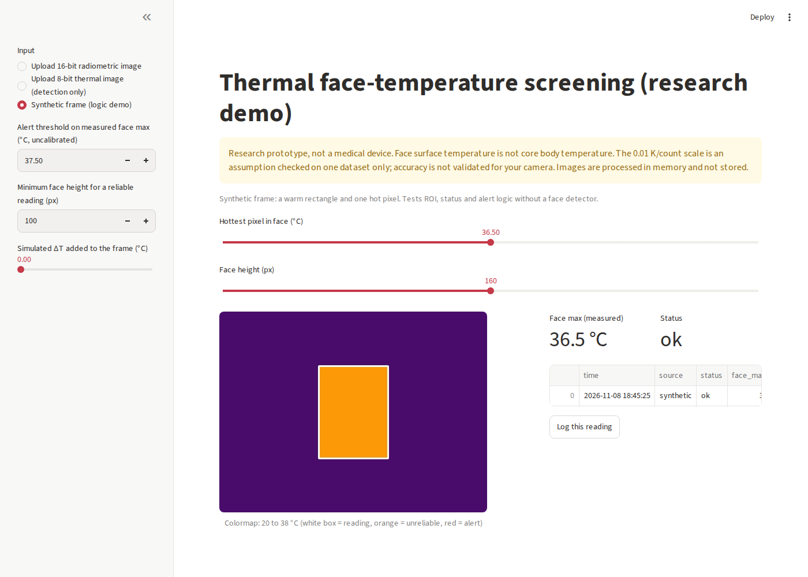
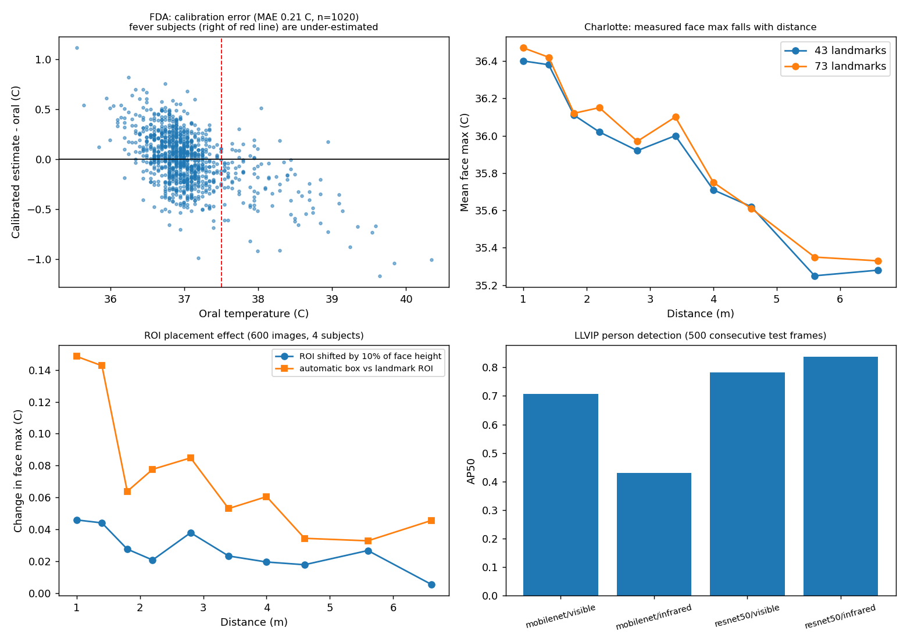
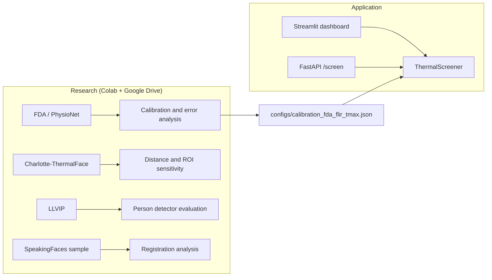
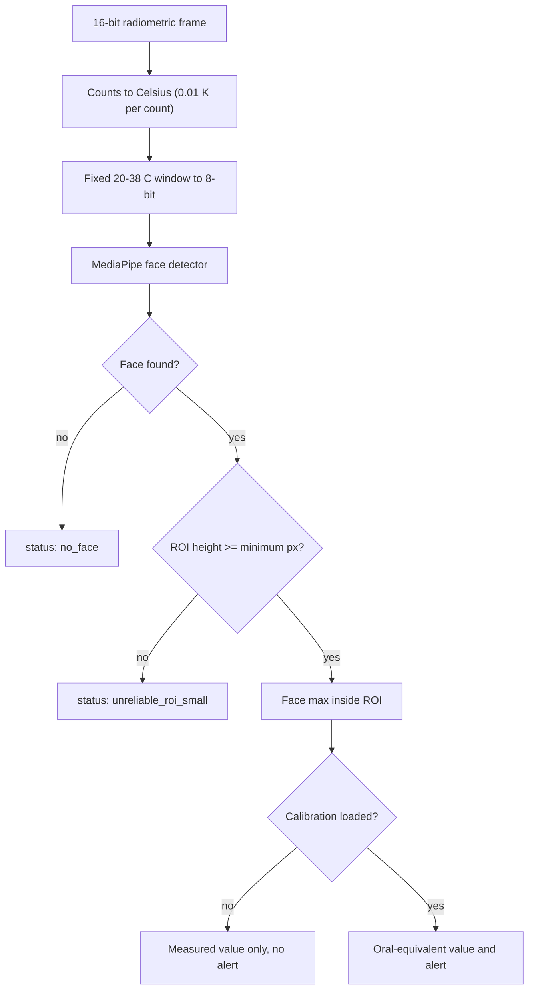

# Thermal Face-Temperature Screening (research prototype)

> **Not a medical device.** Face surface temperature is not core body temperature. The 0.3 °C figure from the
> original brief was reached only under the conditions listed below; end-to-end accuracy with automatic
> face detection could not be validated on any public dataset.

## At a glance

### Face detection and RGB-thermal registration (real data)


*SpeakingFaces (ISSAI, CC BY 4.0), one subject. A homography is estimated from one frame of a camera position and applied to another frame of the same position. The dataset's thermal images are 8-bit, so they carry no temperature. The IoU compares the mapped box with a box MediaPipe finds on the thermal image: a proxy, not ground truth.*

### Screening logic (synthetic frames, not real people)


### Dashboard (synthetic mode)


*Streamlit dashboard in synthetic mode: measured face max, status, a clearly labelled simulated temperature offset, session history and CSV export. Uploads of 16-bit radiometric images are supported. Nothing is stored.*

### Results overview (aggregate numbers from public datasets)


## What it does

A thermal-only pipeline: 16-bit radiometric frame, face box, maximum temperature inside the face ROI,
optional calibration to an oral-equivalent value, alert. It fails safe: no face, a face too small to
measure reliably, invalid input, or no calibration produces a status instead of an alert.
It ships as a Streamlit dashboard and a FastAPI endpoint. All numbers below come from public datasets;
the evaluation scripts and result files are in `docs/results/`.

## Scope against the original brief

| Brief item | Status |
|---|---|
| Person detection | Evaluated on LLVIP (below); optional module, not wired into the dashboard |
| Face detection | MediaPipe on the thermal frame, in the pipeline |
| RGB-thermal alignment | Homography registration module (`src/alignment/registration.py`, tested), demonstrated on one SpeakingFaces subject; not wired into the thermal-only pipeline |
| Face-person association | Not implemented |
| Temperature from thermal data | Implemented (16-bit counts to °C, assumed 0.01 K/count) |
| Error <= 0.3 °C | MAE met, RMSE borderline, only with expert ROI at 0.8 m on one camera model |
| <= 1 s per frame | Face detection, ROI and reading take 4 to 22 ms per frame on a Colab CPU (350x465 frames) |
| Live camera input | Not implemented or tested |
| History and report export | Session history in memory only, CSV download |

## Architecture



## Pipeline



## Results

### 1. Facial temperature vs oral thermometer (FDA dataset, FLIR camera, about 0.8 m)

Features are the dataset's own extracted values (expert ROI), not images. Linear calibration, 5-fold cross-validation, 1,020 subjects.

| Feature | Raw bias (°C) | Calibrated MAE | Calibrated RMSE |
|---|---|---|---|
| T_Max, mean of 4 rounds | -0.94 | 0.210 (95% CI 0.200 to 0.220) | 0.271 |
| Inner canthi max, mean of 4 rounds | -1.24 | 0.248 (95% CI 0.236 to 0.260) | 0.319 |
| T_Max, single round | n/a | 0.234 to 0.259 | 0.304 to 0.333 |
| Inner canthi max, single round | n/a | 0.250 to 0.251 | 0.322 to 0.327 |

* Febrile subjects (oral >= 37.5 °C, n = 111) are under-estimated: MAE 0.313 °C, bias -0.27 °C. At a 37.5 °C threshold sensitivity is 0.76 and specificity 0.98, so about one in four fevers is missed.
* A threshold of 37.2 °C gives sensitivity 0.95 and specificity 0.84, but it was chosen on the same data and is exploratory only.
* Round 4 sits about 0.4 °C below rounds 1 to 3 (per-round residual means +0.15, +0.07, +0.06, -0.29). The cause was not investigated, so one calibration can drift between sessions.
* The saved calibration (slope 0.587, intercept 15.84) is valid for the FDA camera and ROI definition only. Applied to Charlotte-ThermalFace it would flag healthy volunteers, so the application ships uncalibrated.

### 2. Distance effect (Charlotte-ThermalFace, radiometric, 9 of 10 subjects usable)

Mean face-max inside the landmark hull, all subjects pooled (subject mix varies by distance):

| Distance | Face pixels | Face max (°C) |
|---|---|---|
| 1.0 m | ~14,900 | 36.47 |
| 1.4 m | ~7,600 | 36.42 |
| 1.8 m | ~4,600 | 36.12 |
| 2.8 m | ~1,900 | 35.97 |
| 4.0 m | ~900 | 35.75 |
| 6.6 m | ~375 | 35.33 |

* For the 5 subjects recorded at both 1 m and 6.6 m the face max falls by 1.15 to 1.49 °C.
* Downsampling the 1 m images to the 6.6 m face size reproduces only about 19 to 32% of that drop. The remainder is unexplained (optics, camera distance compensation, landmark error and subject cooling are untested hypotheses).
* Consequence: readings are flagged unreliable below a minimum face height (provisional 100 px, which is roughly 1.4 m on this sensor).

### 3. ROI placement (Charlotte-ThermalFace, 600 images, 4 subjects)

| Distance | Shift of ROI by 10% of face height | Automatic box vs landmark ROI, mean abs. difference | IoU with landmark box |
|---|---|---|---|
| 1.0 m | 0.05 °C | 0.15 °C | 0.70 |
| 2.8 m | 0.04 °C | 0.08 °C | 0.59 |
| 6.6 m | 0.01 °C | 0.05 °C | 0.40 |

* Shifting the ROI barely changes the face max (above 0.1 °C in 9% of images at a 10% shift). This holds for a single warm face on a cold background and says nothing about crowds, rotation, scale error or camera parallax.
* The automatic box reads about 0.15 °C higher than the landmark ROI at 1 m, a bias on top of the FDA calibration.

### 4. Person detection (LLVIP, first 500 consecutive test pairs, IoU 0.5, torchvision Faster R-CNN, COCO weights)

| Model / modality | AP50 | Precision | Recall | Median time (T4 GPU) |
|---|---|---|---|---|
| MobileNet / visible | 0.707 | 0.791 | 0.639 | 59 ms |
| MobileNet / infrared | 0.431 | 0.426 | 0.535 | 59 ms |
| ResNet50 / visible | 0.783 | 0.814 | 0.735 | 156 ms |
| ResNet50 / infrared | 0.836 | 0.829 | 0.780 | 155 ms |

On a Colab CPU MobileNet takes about 0.56 s and ResNet50 about 6.9 s per frame, so ResNet50 does not meet the 1 s target on CPU. The 500 frames come from a few scenes and there are no confidence intervals.

### 5. RGB-thermal registration (SpeakingFaces, one subject, two trials)

* The thermal images are 8-bit colorized PNGs, not radiometric, so this dataset is used for registration and detection only.
* The homography between raw and aligned RGB is stable within one camera position (std 0.10 to 0.27 px, 0.16 px over consecutive frames) and differs between the nine positions.
* MediaPipe boxes on RGB and on grayscale thermal frames overlap with median IoU 0.81 (100 frames, one subject), a proxy and not ground truth.

### 6. Error budget (estimate, not measured)

Calibration RMSE 0.30 to 0.33 °C, automatic ROI bias about 0.15 °C and the 1.4 m distance effect about 0.05 °C combine to roughly 0.35 °C RMSE at 1.4 m or closer, assuming independent errors. No public dataset pairs images with an oral reference, so this estimate cannot be checked end to end.

## Limitations

* The 0.01 K/count scale is an assumption: it gives plausible skin temperatures on Charlotte-ThermalFace and FDA face maxima are close (35.8 °C vs 36.4 °C at about 1 m), but absolute accuracy was not checked against a blackbody reference.
* The two cameras differ by about 0.6 °C at comparable distance, so calibrations do not transfer between cameras.
* Public datasets are mostly controlled indoor scenes with a single subject; crowds, outdoor conditions, glasses, masks and fever-range subjects other than FDA's 111 are untested.
* Close-range (about 1 to 1.4 m) screening is the validated regime. Distant crowd monitoring needs higher-resolution optics.
* Charlotte-ThermalFace: one annotation session (S3) is missing from the zip, and S2 has corrupted distance values. Affected rows were excluded.

## Datasets and licences

| Dataset | Used for | Terms |
|---|---|---|
| FDA / PhysioNet face-oral temperature data | Calibration and error analysis | CC0 |
| Charlotte-ThermalFace | Distance and ROI analysis | Research use only, no licence file; images are not redistributed |
| LLVIP | Person-detector evaluation | Non-commercial; images are not redistributed |
| SpeakingFaces (sample, one subject) | Registration analysis | CC BY 4.0 as stated by ISSAI (verify on the Hugging Face dataset card) |

No dataset image is stored in this repository. Pretrained COCO weights come from torchvision and their terms should be checked before any commercial use.

## Privacy and ethics

The tool performs no identification or face recognition. The dashboard keeps readings in session memory only and the API processes uploads in memory. Using thermal screening in public spaces raises consent, retention and discrimination questions that this prototype does not solve.

## Repository layout

src/pipeline/ ThermalScreener (fail-safe screening logic)
src/temperature/ radiometric conversion, FDA baseline analysis
src/detection/ face detector wrapper, person detector (evaluation)
src/utils/ resumable stage tracker (atomic JSON checkpoints)
src/alignment/ early eye-alignment experiment, not used by the pipeline
backend/ FastAPI app
frontend/ Streamlit dashboard
configs/ calibration for the FDA camera only
docs/results/ evaluation outputs
scripts/ Hugging Face Space deployment
tests/ 20 tests


## Run it

```bash
pip install -r requirements.txt
python -m pytest -q
streamlit run frontend/app.py
uvicorn backend.app:app          # then: curl -F "file=@frame.tiff" http://localhost:8000/screen
```

The API accepts single-channel 16-bit images up to 10 MB and returns the status and face max per face. `calibrated` is false unless `CALIBRATION_JSON` points to a calibration file.

## Persistence in Colab

Datasets, checkpoints and results live on Google Drive. A `StageTracker` records completed stages in `progress.json` with atomic writes, so a disconnected runtime resumes where it stopped. Stages whose output lives on the volatile Colab disk must be re-run after a reset (the tracker supports a `verify` check for this).

## Citations

* Charlotte-ThermalFace: "A Novel Fully Annotated Thermal Infrared Face Dataset: Recorded in Various Environment Conditions and Distances From The Camera", arXiv:2205.02093.
* LLVIP: Jia et al., "LLVIP: A Visible-infrared Paired Dataset for Low-light Vision", ICCV Workshops 2021.
* FDA / PhysioNet: https://physionet.org/content/face-oral-temp-data/1.0.0/
* SpeakingFaces: ISSAI dataset page and paper (citation to be verified against the official page).

## Licence

Code: MIT (see `LICENSE`). Dataset terms above apply separately.
