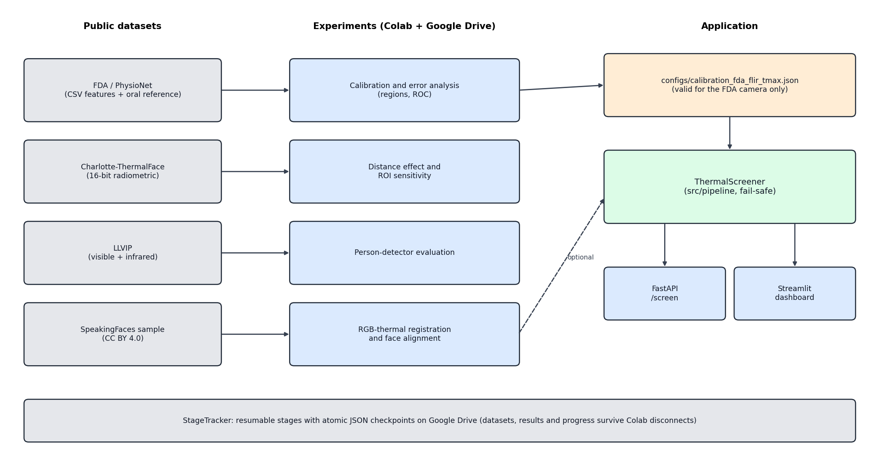
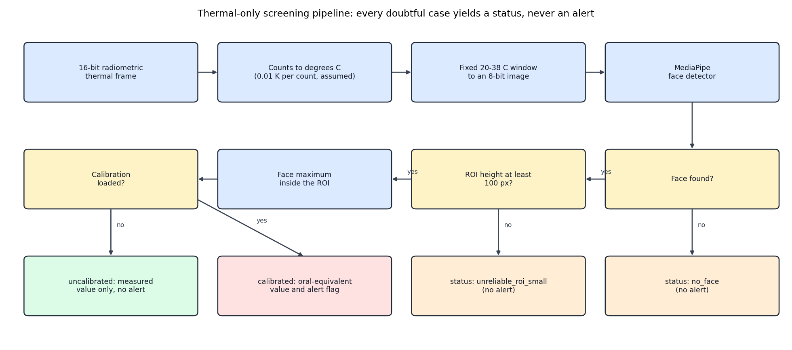
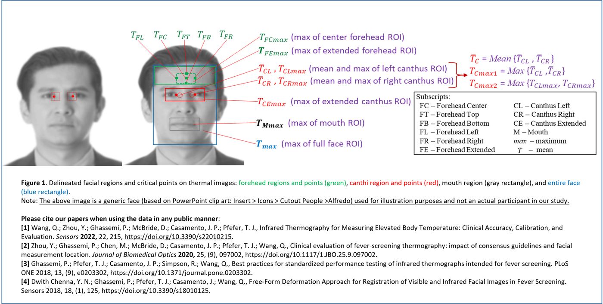
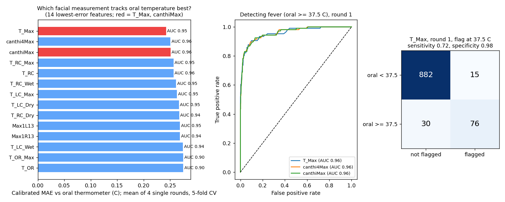
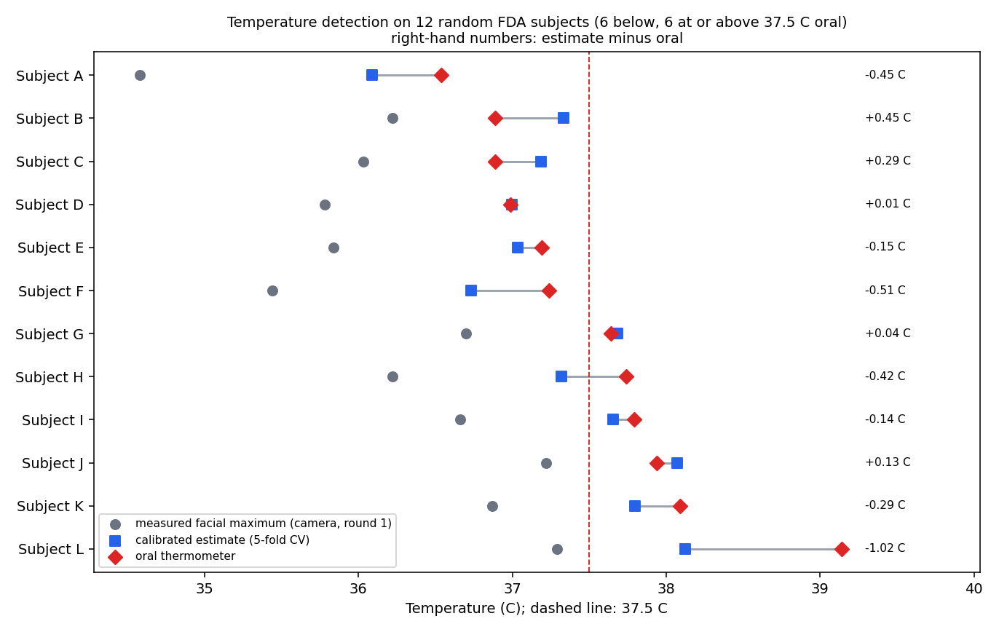
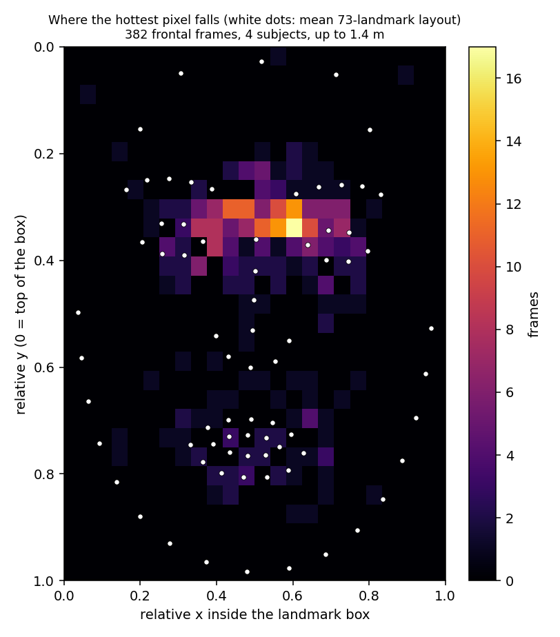
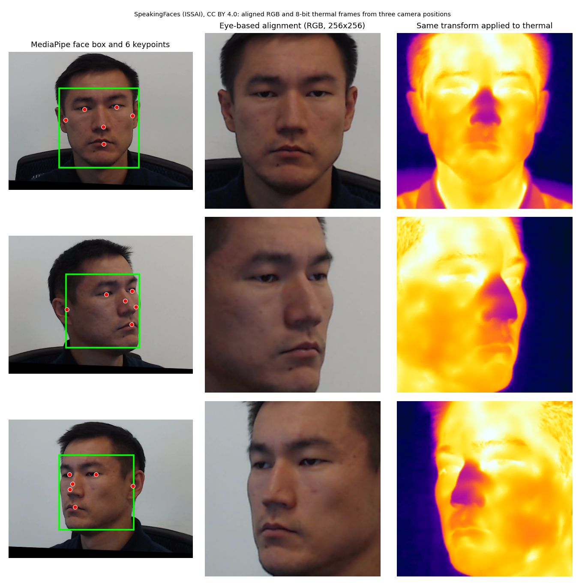
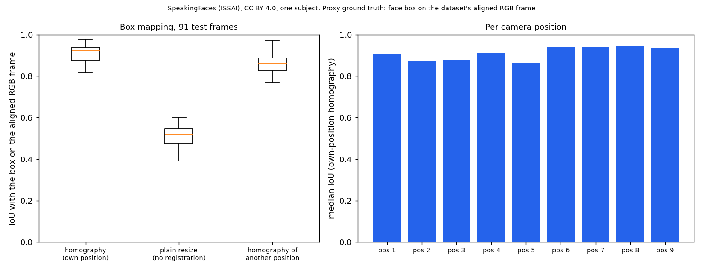
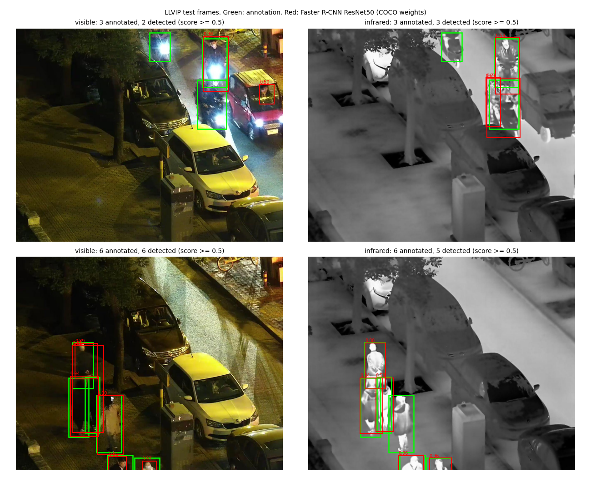
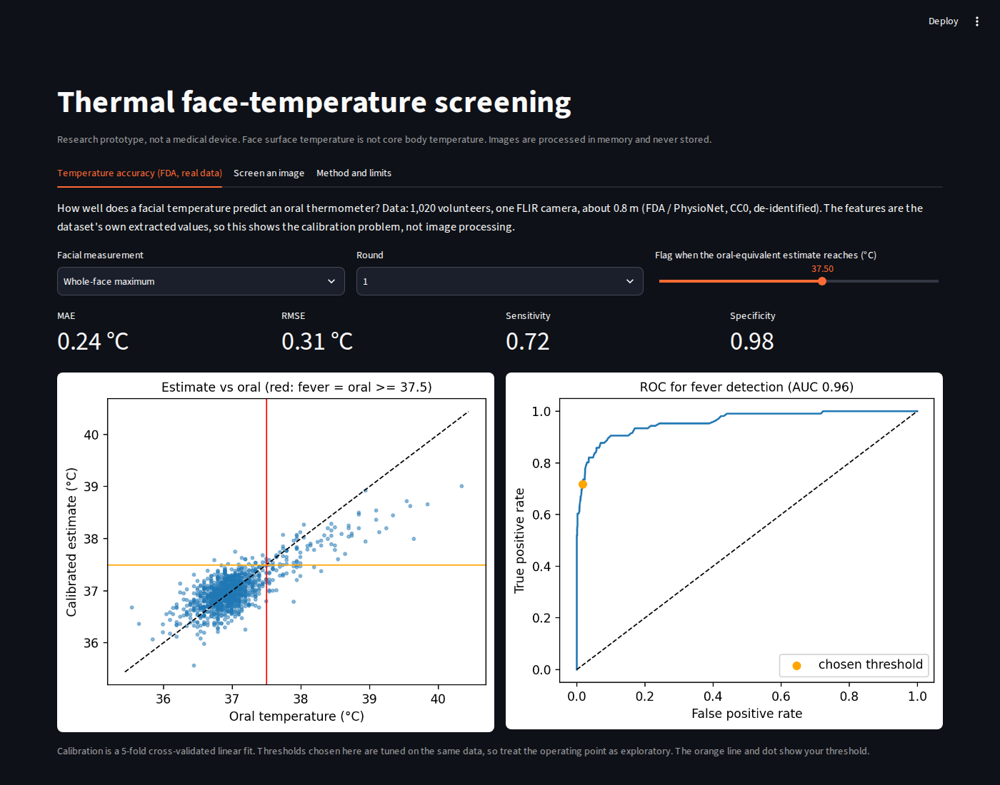

# Thermal Face-Temperature Screening

  

A research prototype that turns a radiometric thermal frame into a face-temperature reading and measures, honestly, how far that reading can be trusted. It combines a fail-safe pipeline with analyses on four public datasets. Every number below comes from a result file in `docs/results/` or from the cited dataset.

> **Not a medical device.** Face surface temperature is not core body temperature. The original brief asked for an error of at most 0.3 °C. That target is met only for expert-extracted face regions at about 0.8 m on one camera model. End-to-end accuracy with automatic face detection could not be validated, because no public dataset pairs thermal images with an oral-temperature reference.

**Contents:** [Key findings](#key-findings) · [Scope](#scope-against-the-original-brief) · [System design](#system-design) · [Results](#results) · [Dashboard and API](#dashboard-and-api) · [Limitations](#limitations) · [Datasets](#datasets-and-licences) · [Repository structure](#repository-structure) · [Quick start](#quick-start) · [Reproducibility](#reproducibility) · [Citations](#citations)

## In one minute

A thermal camera records a temperature for every pixel. This project takes such a frame, finds the face, reads the hottest temperature inside the face region and asks the question that matters for fever screening: **how far can that reading be trusted?**

1. **Reading:** the face-region maximum from a 16-bit thermal frame (skin surface temperature).
2. **Check:** it is compared with an oral thermometer for 1,020 real volunteers (FDA data).
3. **Result:** the raw reading is about 1 °C too low. A linear calibration brings the average error to about 0.2 to 0.3 °C under good conditions, but fevers are under-estimated, distance lowers the reading by more than 1 °C, and a calibration does not transfer to another camera.
4. **Safety:** when in doubt (no face, face too small, no calibration) the software reports a status instead of raising an alert.

## Key findings

1. **Raw facial temperature is not body temperature.** On the FDA data the whole-face maximum reads about 0.9 °C below the oral thermometer and the inner canthus about 1.2 °C below. A linear calibration brings the mean absolute error to 0.21 to 0.25 °C.
2. **The 0.3 °C target holds only in a narrow regime:** single frame MAE 0.23 to 0.26 °C and RMSE 0.30 to 0.33 °C, expert ROI, 0.8 m, one camera. Subjects with fever (n = 111) are under-estimated (bias -0.27 °C); with four-round-averaged features and a 37.5 °C threshold sensitivity is 0.76, so roughly one in four fevers is missed.
3. **Distance matters more than the model.** On Charlotte-ThermalFace the measured face maximum falls by 1.15 to 1.49 °C between 1 m and 6.6 m for the same person. Down-sampling explains only about a quarter of that drop.
4. **Calibrations do not transfer between cameras.** Two cameras differ by about 0.6 °C at comparable distance, so the shipped FDA calibration is not applied by default.
5. **The pipeline fails safe.** No face, a face under 100 px, invalid input or no calibration produces a status, never an alert.


## Scope against the original brief

| Brief item | Status |
|---|---|
| Person detection | Evaluated on LLVIP; optional module, not part of the thermal-only pipeline (ResNet50 needs about 6.9 s per frame on a Colab CPU) |
| Face detection | MediaPipe on thermal frames (in the pipeline) and on RGB frames (demonstrated on SpeakingFaces) |
| RGB-thermal alignment | `HomographyRegistration` and `RgbGuidedScreener` (RGB face, mapped thermal ROI, face maximum), unit tested; box-mapping accuracy evaluated on one SpeakingFaces subject (section 4b). The temperature chain through RGB guidance is not validated: no public dataset has radiometric RGB-thermal pairs with an oral reference |
| Face to person association | Not implemented |
| Temperature from thermal data | Implemented (16-bit counts to °C, assumed 0.01 K per count) |
| Error of at most 0.3 °C | See key finding 2 |
| At most 1 s per frame | Face detection, ROI and reading take 4 to 22 ms on a Colab CPU (350x465 frames) |
| Live camera input | Not implemented or tested |
| History and report export | Session history in memory, CSV download |

## System design





## Results

### 1. Facial temperature vs oral thermometer (FDA / PhysioNet)

One FLIR camera at about 0.8 m, 1,020 subjects, linear calibration with 5-fold cross-validation. Features are the dataset's own extracted values (expert ROI), not images.

| Feature | Raw bias (°C) | Calibrated MAE | Calibrated RMSE |
|---|---|---|---|
| T_Max, mean of 4 rounds | -0.94 | 0.210 (95% CI 0.200 to 0.220) | 0.271 |
| Inner-canthus max, mean of 4 rounds | -1.24 | 0.248 (95% CI 0.236 to 0.260) | 0.319 |
| T_Max, single round | not measured | 0.234 to 0.259 | 0.304 to 0.333 |
| Inner-canthus max, single round | not measured | 0.250 to 0.251 | 0.322 to 0.327 |



*Figure 1 of the FDA / PhysioNet release (CC0): the facial regions in which the study extracted temperatures. Green: forehead. Red: canthi, the inner corners of the eyes. Grey: mouth. Blue: the whole face. The face is a generic illustration, not a participant.*



*Left: which facial measurement tracks the oral temperature best (`T_Max` = whole face, `canthiMax` = inner corners of the eyes, `T_FH_Max` = extended forehead, `T_FHC_Max` = centre forehead, `T_OR_Max` = mouth; see the FDA figure above). Middle: ROC curves for detecting fever (oral >= 37.5 °C). Right: confusion matrix for T_Max at a fixed 37.5 °C flag. The temperature estimate is a measured pixel maximum plus a linear fit, not a neural network, so there is no Grad-CAM; the question "which face region carries the signal" is answered by comparing regions directly (left) and by the hotspot map in section 2.*

### Temperature detection on real subjects (FDA data)



*Twelve subjects drawn at random (six with oral temperature below 37.5 °C, six at or above): the facial maximum measured by the camera (round 1), the calibrated oral-equivalent estimate (5-fold cross-validated) and the oral thermometer. The camera reads about 1 °C low; calibration removes the average offset, but subjects with fever are still under-estimated.*

* Threshold 37.2 °C gives sensitivity 0.95 and specificity 0.84 with four-round features, but it was chosen on the same data and is exploratory only.
* Round 4 sits about 0.4 °C below rounds 1 to 3 (per-round residual means +0.15, +0.07, +0.06, -0.29 °C). The cause was not investigated.
* The saved calibration (slope 0.587, intercept 15.84) is valid for the FDA camera and ROI definition only. Applied to Charlotte-ThermalFace it would flag healthy volunteers.

### 2. Distance effect and where the maximum comes from (Charlotte-ThermalFace)

Mean face maximum inside the landmark hull, all subjects pooled (the subject mix varies by distance):

| Distance | Face pixels | Face max (°C) |
|---|---|---|
| 1.0 m | about 14,900 | 36.47 |
| 1.4 m | about 7,600 | 36.42 |
| 1.8 m | about 4,600 | 36.12 |
| 2.8 m | about 1,900 | 35.97 |
| 4.0 m | about 900 | 35.75 |
| 6.6 m | about 375 | 35.33 |

For the 5 subjects recorded at both 1 m and 6.6 m the face maximum falls by 1.15 to 1.49 °C. Down-sampling the 1 m images to the 6.6 m face size reproduces only 19 to 32% of that drop; optics, camera distance compensation, landmark error and subject cooling are untested explanations. Readings are therefore flagged unreliable below a provisional face height of 100 px (about 1.4 m on this sensor).



*Position of the hottest pixel inside the landmark hull, relative to the landmark box, over frontal frames up to 1.4 m. It describes where the maximum tends to occur; it does not prove that the reading is correct.*

### 3. ROI placement (Charlotte-ThermalFace, 600 images, 4 subjects)

> **Detector note.** The ROI table below was measured with a MediaPipe face detector. After MediaPipe 1.x dropped the legacy `solutions` API the code uses the Tasks API (BlazeFace short-range model). Re-running the same 600 images with it gave the same IoU, ROI difference and detection flag on every row (`docs/results/charlotte_roi_detector_v2.csv`), so the numbers below stand. Why the two runs agree exactly was not investigated.

| Distance | ROI shifted by 10% of face height | Automatic box vs landmark ROI | IoU with landmark box |
|---|---|---|---|
| 1.0 m | 0.05 °C | 0.15 °C | 0.70 |
| 2.8 m | 0.04 °C | 0.08 °C | 0.59 |
| 6.6 m | 0.01 °C | 0.05 °C | 0.40 |

Shifting the ROI barely changes the face maximum (above 0.1 °C in 9% of images at a 10% shift). This holds for one warm face on a cold background and says nothing about crowds, rotation, scale error or camera parallax. The automatic box reads about 0.15 °C higher than the landmark ROI at 1 m, a bias on top of the calibration.

### 4. Face keypoints, alignment and RGB-thermal registration (SpeakingFaces)



*MediaPipe finds the face box and six keypoints (eyes, nose, mouth, ears). The eye keypoints drive a similarity transform that gives a canonical 256x256 crop, and the same transform is applied to the thermal frame. In this dataset the aligned RGB and thermal frames share one geometry. The thermal frames are 8-bit colourised PNGs, so they carry no temperature.*


*A homography estimated once from one frame of a camera position is applied to another frame of the same position. The IoU in the figure title compares the mapped box with a box MediaPipe finds directly on the thermal image: a proxy, not ground truth. The homography is stable within a camera position (standard deviation 0.10 to 0.27 px) and differs between the nine positions.*

### 4b. RGB-to-thermal box mapping (SpeakingFaces, one subject)



*91 test frames from 9 camera positions. For each position one homography is calibrated on a single frame (mean reprojection error 0.32 px, median 83 inliers) and tested on the other frames. Proxy ground truth: the face box MediaPipe finds on the dataset's aligned RGB frame. Median IoU: homography 0.92, plain resize 0.52, homography of another position 0.86; IoU >= 0.5 in 100% / 60% / 100% of frames; median centre error 3.4 / 40.8 / 10.4 px. Plain resize is a weak baseline because the two cameras have very different fields of view (78° RGB, 24° thermal, per the dataset card). One subject, one trial, a proxy and not true ground truth.*

*Reading the registration numbers. The control with another position's homography still reaches IoU 0.86 because the faces here are large (about 200 px wide) and the positions differ by only about 10 px; the centre error (3.4 px with the right homography, 10.4 px with another position's, 40.8 px with a plain resize) separates the cases better than IoU. For scale: in the ROI-shift experiment on Charlotte-ThermalFace a shift of 10% of the face height changed the face maximum by at most 0.05 °C on average per distance, and 10 px is about 5% of a 200 px face. This suggests that registration errors of this size matter little for the face maximum at close range, but it is an indirect estimate from two different datasets.*

### 5. Person detection (LLVIP, first 500 consecutive test pairs, IoU 0.5)

Torchvision Faster R-CNN with COCO weights.

| Model / modality | AP50 | Precision | Recall | Median time (T4 GPU) |
|---|---|---|---|---|
| MobileNet / visible | 0.707 | 0.791 | 0.639 | 59 ms |
| MobileNet / infrared | 0.431 | 0.426 | 0.535 | 59 ms |
| ResNet50 / visible | 0.783 | 0.814 | 0.735 | 156 ms |
| ResNet50 / infrared | 0.836 | 0.829 | 0.780 | 155 ms |

On a Colab CPU MobileNet takes about 0.56 s and ResNet50 about 6.9 s per frame. The 500 frames come from a few scenes and there are no confidence intervals.



*Two LLVIP test frames shown to document non-commercial research (Jia et al., ICCV Workshops 2021; terms: https://github.com/bupt-ai-cz/LLVIP/blob/main/Term%20of%20Use%20and%20License.md). Green: annotation, red: detection. The dataset blurs faces and prohibits identifying people.*

### 6. Error budget (estimate, not measured)

Calibration RMSE 0.30 to 0.33 °C, automatic-ROI bias about 0.15 °C and the 1.4 m distance effect about 0.05 °C combine to roughly 0.35 °C RMSE at 1.4 m or closer, assuming independent errors. It cannot be checked end to end because no public dataset pairs images with an oral reference.

Registration (RGB-guided mode only): about 3 px median centre error in the SpeakingFaces test, which the ROI-shift experiment suggests changes the face maximum by well under 0.05 °C at close range (indirect, see section 4b). It is not part of the sum above, which describes the thermal-only pipeline.

## Dashboard and API

The Streamlit dashboard (`streamlit run frontend/app.py`) has three tabs: **Screen an image** (upload a 16-bit radiometric frame for a measured face maximum, status and CSV report, or an 8-bit frame for detection only), **FDA calibration explorer** (choose a facial measurement and a threshold, see MAE, RMSE, sensitivity, specificity, scatter and ROC on the 1,020 FDA subjects) and **Method and limits**. Nothing is stored. The bundled FDA table contains no subject identifiers or demographics.



*Dashboard tab with the FDA data: pick a facial measurement, a round and a threshold; the metrics, scatter plot and ROC update.*

The FastAPI endpoint (`uvicorn backend.app:app`) accepts a single-channel 16-bit image up to 10 MB at `POST /screen` and returns the status and face maximum per face. `calibrated` is false unless `CALIBRATION_JSON` points to a calibration file.

## Limitations

* The 0.01 K per count scale is an assumption. It gives plausible skin temperatures on Charlotte-ThermalFace and its face maxima are close to the FDA ones (35.8 °C vs 36.4 °C at about 1 m), but absolute accuracy was not checked against a blackbody reference.
* The two cameras differ by about 0.6 °C at comparable distance, so calibrations do not transfer.
* Public datasets are mostly controlled indoor scenes with one subject. Crowds, outdoor conditions, glasses, masks and fever-range subjects beyond FDA's 111 are untested.
* Close-range screening (about 1 to 1.4 m) is the validated regime. Distant crowd monitoring needs higher-resolution optics.
* Charlotte-ThermalFace: one annotation session (S3) is missing from the zip and S2 has corrupted distance values; affected rows were excluded.
* SpeakingFaces thermal frames provided here are 8-bit colourised images, so the dataset supports detection and registration only.
* Deployment to a hosted demo is paused; the repository contains the scripts for a Hugging Face Space.

## Datasets and licences

| Dataset | Used for | Terms |
|---|---|---|
| FDA / PhysioNet face and oral temperature data | Calibration and error analysis; de-identified table bundled with the dashboard | CC0 |
| Charlotte-ThermalFace | Distance and ROI analysis | Research use only, no licence file; images are not redistributed |
| LLVIP | Person-detector evaluation | Non-commercial; images are not redistributed |
| SpeakingFaces (sample, one subject) | Detection and registration figures | CC BY 4.0 (ISSAI); participants consented to public sharing |

Pretrained COCO weights come from torchvision; check their terms before any commercial use.

## Repository structure

```text
.
├── README.md
├── LICENSE
├── requirements.txt
├── configs/            calibration for the FDA camera only (not transferable)
├── src/
│   ├── pipeline/       ThermalScreener (thermal-only), RgbGuidedScreener (RGB face to thermal ROI)
│   ├── temperature/    radiometric conversion, FDA baseline analysis
│   ├── detection/      face detector wrapper, person detector (LLVIP evaluation)
│   ├── alignment/      HomographyRegistration, eye-based FaceAligner
│   └── utils/          StageTracker: resumable stages, atomic checkpoints
├── backend/            FastAPI /screen endpoint
├── frontend/           Streamlit dashboard and bundled FDA table
├── scripts/            make_figures.py, make_figures_extra.py, alignment_eval.py, roi_detector_check.py, deploy_space.py
├── notebooks/          research log (Colab)
├── docs/
│   ├── images/         figures used in this README
│   └── results/        evaluation outputs (JSON and CSV)
├── deploy/             Hugging Face Space files (deployment paused)
└── tests/              unit, API and dashboard tests
```

## Quick start

```bash
pip install -r requirements.txt
python -m pytest -q
streamlit run frontend/app.py
uvicorn backend.app:app          # then: curl -F "file=@frame.tiff" http://localhost:8000/screen
```

## Reproducibility

* Research ran on Google Colab with datasets, checkpoints and results on Google Drive. `StageTracker` records finished stages in `progress.json` with atomic writes, so a disconnected runtime resumes where it stopped. Stages whose output lives on the volatile Colab disk must be re-run after a reset (the tracker supports a `verify` check).
* `scripts/make_figures.py` regenerates the diagrams, the FDA region figure, the hotspot map and the keypoint figure from the datasets on Drive. The registration figure and the results overview come from the research notebook in `notebooks/`, whose outputs are cleared because dataset images may not be redistributed.

## Privacy and ethics

The tool performs no identification or face recognition. The dashboard keeps readings in session memory only and the API processes uploads in memory. Thermal screening in public spaces raises consent, retention and discrimination questions that this prototype does not solve.

## Citations

* Charlotte-ThermalFace: "A Novel Fully Annotated Thermal Infrared Face Dataset: Recorded in Various Environment Conditions and Distances From The Camera", arXiv:2205.02093.
* LLVIP: Jia et al., "LLVIP: A Visible-infrared Paired Dataset for Low-light Vision", ICCV Workshops 2021.
* FDA / PhysioNet: https://physionet.org/content/face-oral-temp-data/1.0.0/
  The dataset authors ask that these papers are cited when the data is used:
  1. Wang Q, Zhou Y, Ghassemi P, McBride D, Casamento JP, Pfefer TJ. Infrared Thermography for Measuring Elevated Body Temperature: Clinical Accuracy, Calibration, and Evaluation. Sensors 2022, 22, 215. https://doi.org/10.3390/s22010215
  2. Zhou Y, Ghassemi P, Chen M, McBride D, Casamento JP, Pfefer TJ, Wang Q. Clinical evaluation of fever-screening thermography: impact of consensus guidelines and facial measurement location. Journal of Biomedical Optics 2020, 25(9), 097002. https://doi.org/10.1117/1.JBO.25.9.097002
  3. Ghassemi P, Pfefer TJ, Casamento JP, Simpson R, Wang Q. Best practices for standardized performance testing of infrared thermographs intended for fever screening. PLoS ONE 2018, 13(9), e0203302. https://doi.org/10.1371/journal.pone.0203302
  4. Dwith Chenna YN, Ghassemi P, Pfefer TJ, Casamento J, Wang Q. Free-Form Deformation Approach for Registration of Visible and Infrared Facial Images in Fever Screening. Sensors 2018, 18(1), 125. https://doi.org/10.3390/s18010125
* SpeakingFaces: Abdrakhmanova, Kuzdeuov, Jarju, Khassanov, Lewis, Varol, "SpeakingFaces: A Large-Scale Multimodal Dataset of Voice Commands with Visual and Thermal Video Streams", Sensors 21(10):3465, 2021, doi:10.3390/s21103465. ISSAI dataset: doi:10.48333/SMGD-YJ77.

## Licence

Code: MIT (see `LICENSE`). Dataset terms above apply separately.
